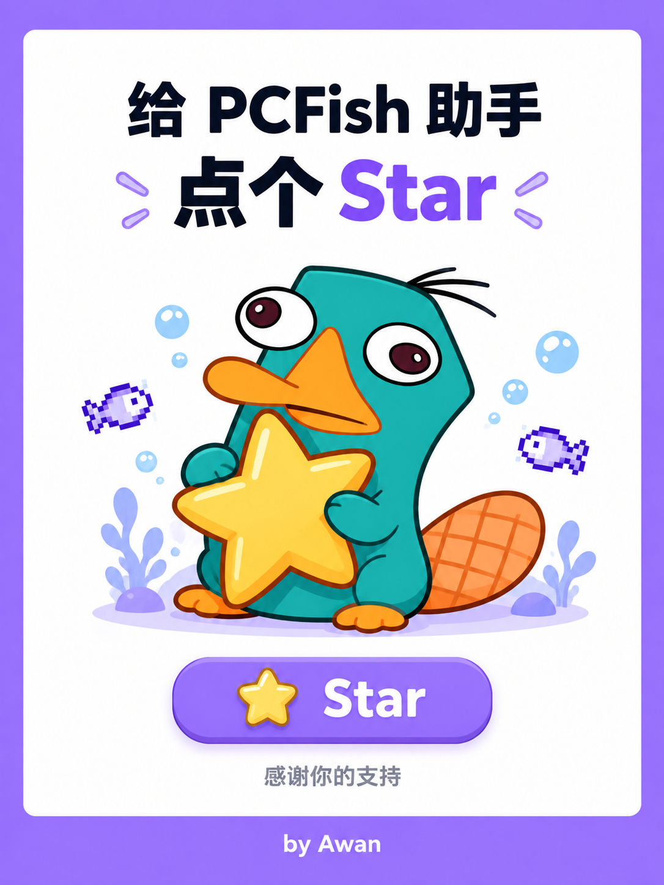

  
  

# PCFish Controller

A background assistant for the idle fish-breeding game PCFish. It runs the breeding loop and the tank upgrades for you, while the game window sits minimized or behind other windows.
The BepInEx console hides on startup, and file logging continues.

## How it is built

| Component | Role |
|---|---|
| `PCFishFrida/` | Plugin-free worker. Attaches to the game by PID, loads an agent in-process, and listens on `127.0.0.1:27778`. |
| `PCFishController/` | Standalone desktop app. Shows status and sends actions. |
| `pcfish-autohelper/` | Legacy BepInEx plugin, kept as a compatibility fallback. |

Frida is the default connection. The worker waits 60 seconds after the game process starts, then attaches by PID. Actions remain paused until the game has a Steam sign-in token and its network stays idle for 30 seconds. The controller is a WinForms app; closing it leaves the game running. Settings > Game connection offers Auto, Frida and Plugin modes.

## What it does

- Overview shows run status, game connection, fish count, breeding counter and tank level. Start All and Stop All control automatic breeding and upgrade checks
- Every 15-30 minutes (configurable), reads the breeding counter and breeds until it reaches zero, then waits for the next check
- Picks fish by your goal route, or by rarity and stars; skips fish on cooldown, out of breed uses, locked, or displayed
- Skips direct parent-child pairs, and avoids combinations the server rejected
- Keeps at least 60 seconds between actions, enforced by the connection layer and the controller
- Verifies breeding results against parent counts and the returned new fish ID
- Reads your remaining breed counts from the server before each round, to filter out a stale local cache
- Tracks delayed replies and checks fish changes before resuming a timed-out request
- Runs auto synthesis when the warehouse passes a configurable threshold (900 by default). The market filter defaults to ¥1 and protects fish above the selected CNY amount; unmapped fish remain protected until a quote is matched
- Pauses auto synthesis when the Steam listing scan is incomplete. S1 and S2 are individually selectable, and each season's recipe fish can also be excluded; the fish exclusion dialog shows icons, prices, counts, rarity, and stars
- Selects 10 fish with the same rarity and star grade; synthesis and breeding each support high/low rarity or high/low star priority
- Confirms each craft by re-reading the fish list
- Synthesis records fish IDs in the hidden merge object, sends the request through the game's native merge method, receives the game callback and verifies fish-list changes
- Dismisses the game's own dialog (for example "a network error occurred") when it appears, records it, and retries later
- A configurable safety wait (5 seconds by default) runs after each craft before the next action
- Closes the game's own "invite a friend for a free heart" popup when it appears. That window covers the function window, so the assistant clicks its Close button through the game's own entry point, leaving other dialogs untouched
- Dismisses a blocking `UIAlterMessage` through its game `Hide()` method after checking the game input-block state

## Interface

Overview, Auto Breeding, Auto Synthesis, Warehouse, Synthesis Route, Logs and Settings. Auto Breeding and Auto Synthesis each support high/low rarity or high/low star priority. The Warehouse caches complete Steam quote scans and supports scheduled refresh, price-range filtering, scheduled export, batch limits, and multi-select exclusions for seasons, recipe fish, and individual species. Automatic export starts disabled and requires explicit confirmation when enabled; exported fish leave the game warehouse for Steam Inventory. S2 recipes and five new regular fish are read from the installed game data. Settings offers 10 FPS and 30 FPS caps and multi-open controls for Sandboxie launch and selecting one PID for the assistant to control. Changing the PID takes effect after restarting the assistant. Fish icons ship as a correctly repacked atlas matched by inventory `sp`. The interface supports Chinese and English.

## Plugin compatibility setup

Frida mode starts from the game and assistant. The Settings setup button installs or updates the legacy BepInEx plugin when Plugin mode is selected. The build script publishes the Frida assistant by default; `-DeployPlugin` builds and deploys the legacy plugin.

The Synthesis Route uses the game's rarity colors for fish names. Yellow, blue and green mark missing materials, sufficient quantities and season fish ready to synthesize in both the route and table.

## Safety

The worker listens on `127.0.0.1`. Plugin mode requires the game's external-action switch and the controller ARM toggle. Frida mode connects by PID and calls the game's native entry points. The assistant stops the current action after an error, and its logs contain no authentication tokens.

## Requirements

Windows 10/11 64-bit and PCFish (Steam). The release download carries its own runtime, so it needs no separate .NET install. Building the controller needs the .NET 8 SDK; the Frida worker needs the .NET 10 SDK; the legacy plugin needs the .NET 6 SDK or newer.
